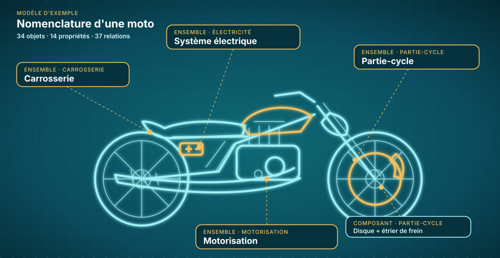
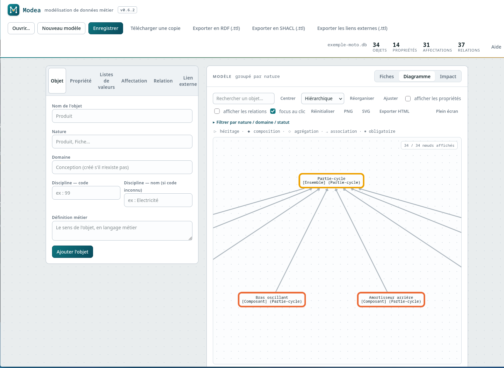

# Modea

**Décrire son domaine avec des listes déroulantes, et voir le graphe se dessiner.**

Modea est un éditeur de modélisation de domaine : on décrit les objets d'un domaine, leurs propriétés et leurs relations en choisissant dans des listes, et le diagramme se met à jour en direct. Il tient dans **un seul fichier HTML**, sans serveur, et fonctionne **hors-ligne** : un double-clic suffit.

> Statut : prototype (version courante : **v0.6**, voir les notes de version dans l'outil, en cliquant sur le badge de version).

Le modèle d'exemple « moto » : 34 objets, 14 propriétés, 37 relations (<code>scripts/generate_sample_moto_db.py</code>).

## Le problème

Décrire un domaine (ses objets, ce qui les caractérise, comment ils se relient) se fait souvent dans un tableur, où personne ne voit la structure d'ensemble. Les outils de modélisation dédiés (Modelio, ArchiMate…) sont puissants mais lourds à mettre en place quand il faut simplement *initialiser* un modèle et le faire relire par les experts du domaine.

Modea est né d'un besoin précis : adapter son propre modèle de domaine tout en gardant sous les yeux les normes de référence.

## Ce que fait Modea

- **Saisie guidée** : on choisit l'objet dans une liste, jamais un identifiant. Les champs contraints (types de propriété, cardinalités, nature des liens) sont limités aux valeurs que le schéma autorise : le modèle reste cohérent.
- **Trois vues** :
  - les **fiches** (objets, propriétés, relations) ;
  - le **diagramme** interactif (Cytoscape), filtrable par nature, domaine et statut, avec des configurations favorites ;
  - l'**analyse d'impact**, de la propriété vers les objets et inversement, à profondeur réglable.
- **Curation** : ajout, édition et suppression ; statut brouillon / validé / obsolète ; détection d'un schéma de base trop ancien.
- **Exports** : modèle en **RDF/OWL** et **SHACL** (Turtle) ; diagramme en **PNG**, **SVG** ou **page HTML autonome** navigable, à partager sans donner accès à l'outil.
- **Hors-ligne et sans lock-in** : le moteur SQLite et la bibliothèque de graphe sont embarqués dans la page ; le modèle est un simple fichier `.db`.

## Interopérabilité : exports RDF/OWL et SHACL

Le modèle sort en **Turtle**, trois fichiers nommés d'après la base (`<modele>.ttl`, `<modele>.shapes.ttl`, `<modele>.liens.ttl`). L'éditeur demande une **IRI de base** : celle par défaut est `http://example.org/modea/<modele>#`, à remplacer par une IRI réelle avant de partager les fichiers. Utiliser la **même IRI** pour l'export RDF/OWL et l'export SHACL, et les régénérer ensemble si le modèle change.

| Modèle Modea | Export RDF/OWL |
|---|---|
| objet | `owl:Class` |
| propriété | `owl:DatatypeProperty` partagée, restreinte par objet (affectation) via `owl:Restriction` |
| relation de généralisation | `rdfs:subClassOf` |
| association, composition, agrégation | `owl:ObjectProperty` + restriction de cardinalité |
| liste de valeurs (enum) | `rdfs:Datatype` avec `owl:oneOf` |
| domaine, nature, discipline | schémas **SKOS** (`ConceptScheme` / `Concept`) ; la nature reste une classification, jamais un `rdfs:subClassOf` |
| informations propres à Modea (statut, origine, unité…) | propriétés d'annotation du vocabulaire `modea:` (`http://example.org/modea-vocab#`) |

L'export **SHACL** cible les mêmes classes et propriétés : une forme par objet (`sh:targetClass`), les cardinalités des affectations et des relations, et les contraintes de valeur (`sh:pattern`, min/max, énumérations) portées par une forme réutilisable par propriété. Quand un même verbe relie un objet à plusieurs types d'objets (« contient » un moteur, une boîte…), les cardinalités sont comptées par type visé (`sh:qualifiedValueShape`).

**Ce qui a été vérifié** (sur le modèle d'exemple « moto », avec `rdflib` et `pyshacl`) :
- les trois fichiers Turtle se chargent sans erreur ; toutes les IRI utilisées sont déclarées ;
- le fichier SHACL est valide au sens SHACL (méta-validation `pyshacl`) ;
- sur des instances d'exemple, les données correctes sont acceptées et les données incomplètes (propriété obligatoire absente, composant manquant ou en trop) sont rejetées.

**Ce qui n'a pas été vérifié** : l'ouverture des exports dans des outils d'ontologie comme Protégé ou TopBraid EDG, et la conformité OWL 2 DL par un raisonneur. Les retours sont les bienvenus.

## Travailler à plusieurs avec GitLab

Le modèle peut être ouvert et enregistré dans un dépôt **GitLab**, directement depuis Modea : personne n'a besoin de connaître git. L'API REST v4 est appelée par le navigateur avec le **jeton d'accès personnel** de chacun (portée `api`, rôle Developer ou plus), comme dans 3DX Class Architect.

- **GitLab…** : adresse, projet, branche et chemin du fichier (`gitlab.*` dans la table `meta` du modèle, donc partagés avec lui) ; le jeton reste dans le navigateur (mémoire de session, ou `localStorage` si « Se souvenir du jeton ») et n'est jamais écrit dans le modèle.
- **Enregistrer dans GitLab** : un commit contenant le `.db` (référence) et un export texte trié `.sql` (pour lire les différences dans GitLab), avec un message résumé (« 2 objets ajoutés, 1 relation modifiée »). Chaque enregistrement est une sauvegarde datée et signée.
- **Pas d'écrasement** : le commit indique la version lue (`last_commit_id`) ; GitLab le refuse si quelqu'un a enregistré entre-temps. Modea l'explique et propose de télécharger sa version puis de recharger. Une vérification chaque minute signale les nouvelles versions.
- **Versions enregistrées** : consulter, restaurer (nouveau commit, historique conservé), poser un jalon (tag).

Pour que deux versions du même modèle puissent être comparées, chaque ligne porte un **identifiant stable** (`uid`, schéma v7). Une base v6 est migrée à l'ouverture avec des `uid` déterministes (`objet-12`) : deux personnes qui migrent la même base obtiennent les mêmes. Prochaine étape envisagée : fusionner automatiquement deux enregistrements concurrents au lieu de refuser le second. Test : `node scripts/test_gitlab.cjs` (faux serveur GitLab, deux utilisateurs simulés).

## Démarrer

1. Ouvrir `modea-editeur.html` dans Chrome ou Edge (double-clic).
2. Charger `nouveau-modele.db` (base vierge de référence) ou un modèle existant.
3. Saisir, explorer, puis enregistrer : Chrome et Edge réécrivent directement le fichier `.db`, les autres navigateurs le téléchargent.

Pour travailler sur une copie, `copie-db.bat` (Windows) copie `nouveau-modele.db` en `modea-donnees.db`. Le bouton d'aide de l'outil ouvre le manuel utilisateur.

## Comment ça marche

Le socle est un **métamodèle neutre** dans **SQLite** : les tables *décrivent* les objets du domaine, elles ne *sont* pas les objets. Cette neutralité permet de projeter le modèle vers UML ou ArchiMate sans se fermer de porte.

| Table | Rôle |
|---|---|
| `domaine` | regroupement fonctionnel |
| `classe_objet` | nature des objets (classification, pas héritage) |
| `objet` | entité du domaine : nom, définition, domaine, nature, statut |
| `propriete` | attribut d'un objet : type, obligatoire, multivalué, contraintes |
| `relation` | lien orienté : association, composition, agrégation, généralisation, cardinalités, rôles |
| `meta` | réglages partagés avec le modèle (emplacement GitLab) ; chaque table porte aussi un `uid` stable |

Les vues `saisie_objet`, `saisie_propriete` et `saisie_relation` (avec triggers `INSTEAD OF`) permettent d'insérer **par nom** : aucun id manipulé à la main. C'est aussi le chemin d'un import automatisé.

Fichiers utiles :

| Fichier | Contenu |
|---|---|
| `modea-editeur.html` | l'application (page autonome) |
| `metamodele.sql`, `saisie.sql` | schéma et vues de saisie, à garder synchronisés avec le schéma embarqué dans l'éditeur |
| `demo-cytoscape.html` | démonstrateur de graphe, ouvre un `.db` en lecture |
| `scripts/` | `generate_sample_moto_db.py` (modèle d'exemple « moto »), `generate_sample_db.py`, `validate_schema.py`, `inline_vendor.py`, `test_gitlab.cjs` (enregistrement GitLab à deux) |
| `vendor/` | sql.js, Cytoscape et cytoscape-svg, injectés dans les pages par `inline_vendor.py` |
| `brief-mdm-claude-code.md` | contexte du projet et questions ouvertes |

## Développement

- Pas de build : on édite directement `modea-editeur.html`.
- Après un changement dans `vendor/` : `python3 scripts/inline_vendor.py`.
- Chaque évolution visible met à jour, dans le même commit, `CHANGELOG` et `APP_VERSION` (en tête du script), `<meta name="version">`, et crée le tag git. Voir `CLAUDE.md`.
- Évolution du schéma : incrémenter `SCHEMA_VERSION` dans l'éditeur **et** dans `metamodele.sql`.

## Licence

MIT, voir [LICENSE](LICENSE).
